<p align="center">
  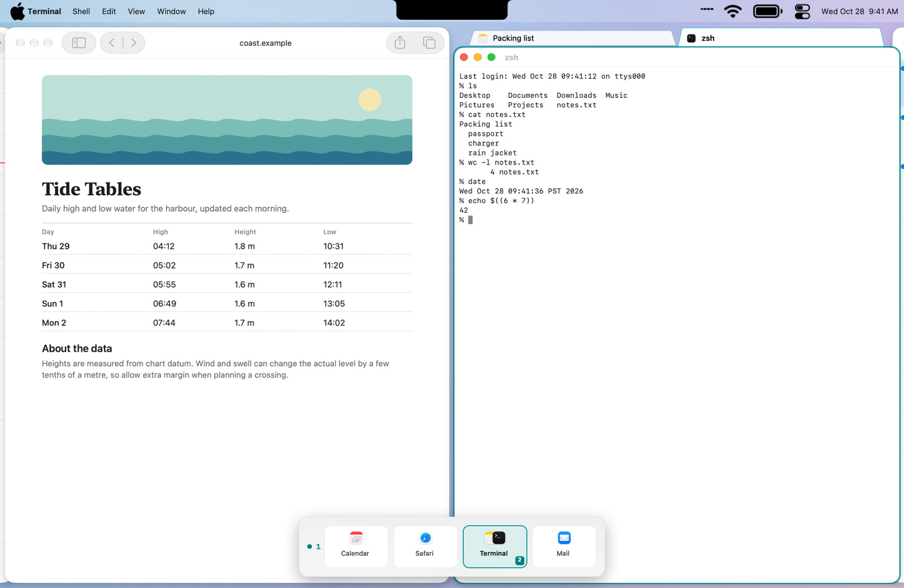
</p>

# Microfish

Microfish is a scrolling, tiling window manager for macOS, in the style of niri and PaperWM. Windows sit
in columns on a strip that scrolls sideways. A column can hold a stack or a set of tabs, and optional
rows put several strips on one display. A three-finger swipe scrolls the strip, and a minimap shows
where you are.

It has two parts:

- **The engine** is a patched build of [Paneru](https://github.com/karinushka/paneru), a Rust/Bevy
  window manager by Karinushka and contributors. It finds windows, lays them out, handles keys and
  gestures, and saves and restores your session.
- **The Microfish app** is a native AppKit/SwiftUI companion. It draws the minimap, the folder-style
  tab bars and the menu-bar window map, and it has a Settings window with a shortcut recorder.

The name is a play on microfiche.

## Download

[](https://github.com/elenaOnline/microfish/releases)

- [Microfish-0.1.0-beta.1.zip](https://github.com/elenaOnline/microfish/releases/download/v0.1.0-beta.1/Microfish-0.1.0-beta.1.zip)
  (11.0 MB), for Apple silicon Macs on macOS 15 or later. It has only been tested on macOS 27.
- The download button on [elenaonline.github.io/microfish](https://elenaonline.github.io/microfish/) looks
  up the newest build, beta or not. The [releases page](https://github.com/elenaOnline/microfish/releases)
  lists all of them.

Microfish is in beta. There is no stable release yet.

## Install

1. Unzip the download and move **Microfish** into the **Applications** folder. Microfish only runs from
   there (or from `~/Applications`); elsewhere it shows a "Move Microfish to the Applications folder" alert.
2. Open Microfish. macOS says it was downloaded from the internet and asks whether to open it. The app is
   signed with a Developer ID and notarized by Apple, so choose **Open**. A menu-bar icon appears.
3. If Microfish says it needs your approval, open **System Settings › General › Login Items & Extensions**
   and allow the Microfish background item (it may be listed as **Microfish** or **Microfish Engine**), then
   open Microfish again.
4. When the alert "Allow Microfish to Control Windows" appears, choose **Continue**. Then turn on both
   **Microfish Engine** and **Microfish** in **System Settings › Privacy & Security › Device Control and
   Data Access**. On macOS before 27 that pane is called **Accessibility**. The engine moves and resizes
   windows; the app raises and focuses them from the tab bars and the window map. Windows start tiling
   once the engine has access.
5. If three fingers already switch full-screen apps, set **System Settings › Trackpad › More Gestures ›
   Swipe between full-screen applications** to four fingers, or change Microfish to four fingers in
   **Settings › Behavior › Swipe with**.

Screen Recording is optional. It is only used by **Match selected tab to app color** in **Settings ›
Appearance**. Microfish has no network access apart from update checks, and it collects nothing.

### Homebrew

```sh
brew trust elenaonline/tap
brew install --cask elenaonline/tap/microfish
```

The cask lives in [elenaOnline/homebrew-tap](https://github.com/elenaOnline/homebrew-tap) and installs the
newest published build, which today is the beta. Homebrew 7 refuses casks from a tap you haven't trusted,
which is what the first line is for (older Homebrew has no `brew trust`; skip it there). Microfish updates itself (see [Updates](#updates)), so `brew upgrade`
leaves it alone unless you pass `--greedy`.

## A tour

**Swipe.** A three-finger swipe scrolls the strip sideways and it glides to a stop. Holding Hyper and
scrolling does the same. Keyboard moves are instant cuts.

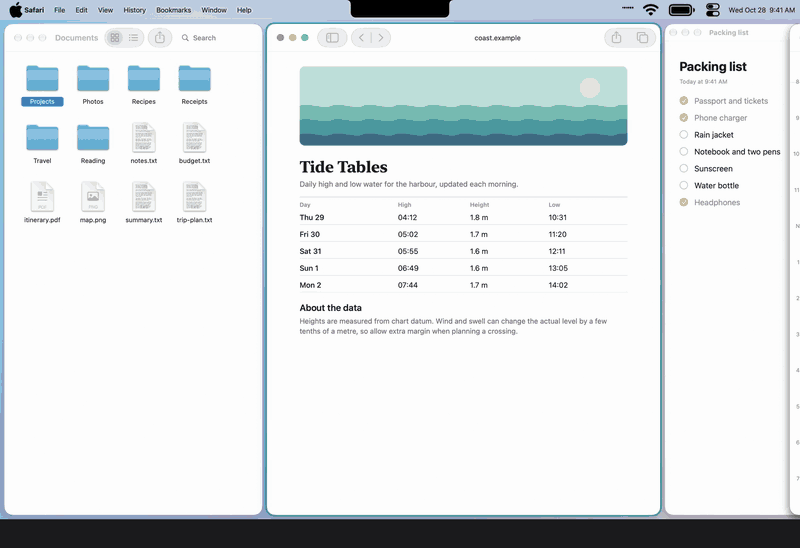

**Focus and move.** **Hyper ← →** focuses the neighboring column. **Hyper ⇧ ← →** swaps the focused window
with it.

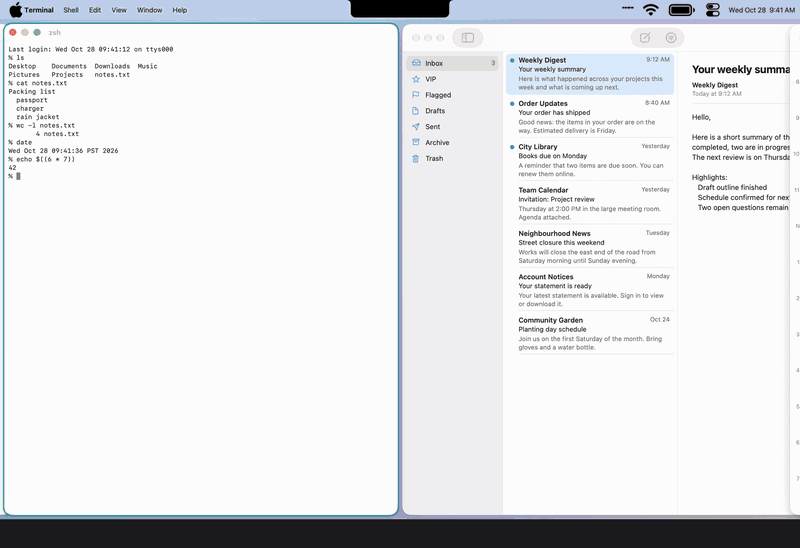

**Widths.** **Hyper R** cycles a column through a third, a half, two thirds and the full width of the
screen; **Hyper ⇧ R** cycles back. **Hyper F** is full width and **Hyper C** centers.

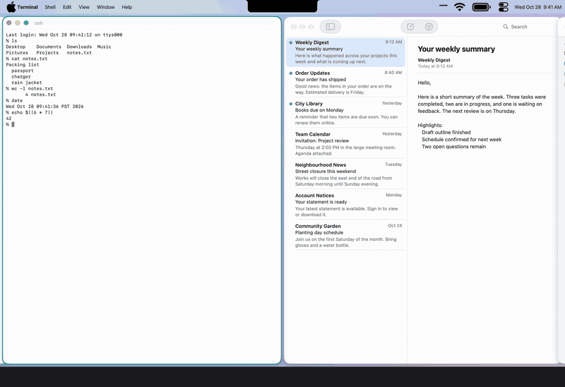

**Stacks and tabs.** **Hyper [** and **Hyper ]** stack the focused window into the column to its left or
right. **Hyper T** shows a stack as tabs, with a folder-style tab bar, and **Hyper K J** switch between
them. **Hyper \\** unstacks.

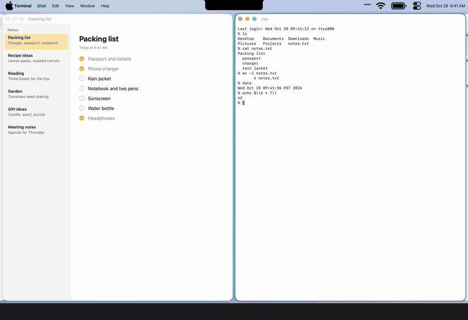

**Rows.** Rows are off by default. Turn on **Virtual rows** in **Settings › Rows**, and **Hyper ↑ ↓** moves
between strips stacked vertically on the display.

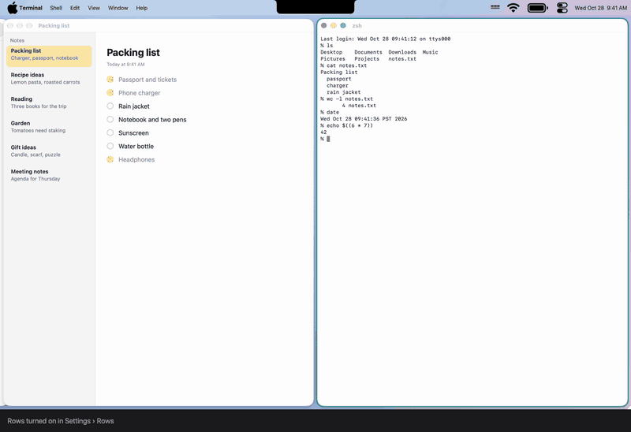

**Minimap.** Holding Hyper, swiping or scrolling shows a minimap of the strip. **Settings › Minimap** picks
its style (Cards, Compact or Titles), position and timing.

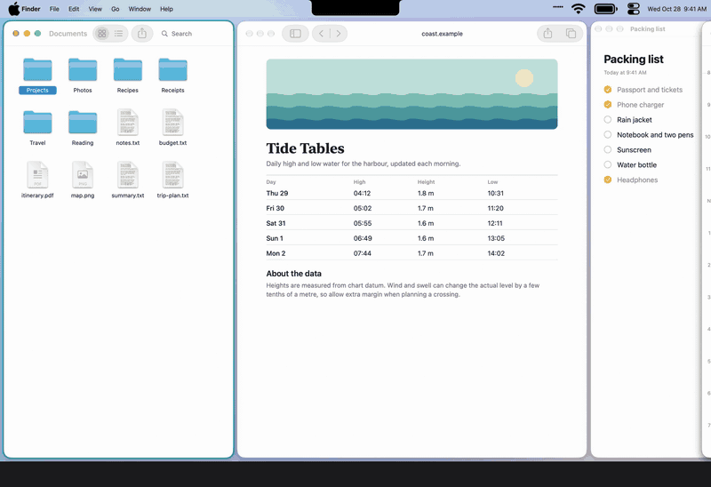

The three layouts, shown here with Rows turned on (two rows):

<p>
  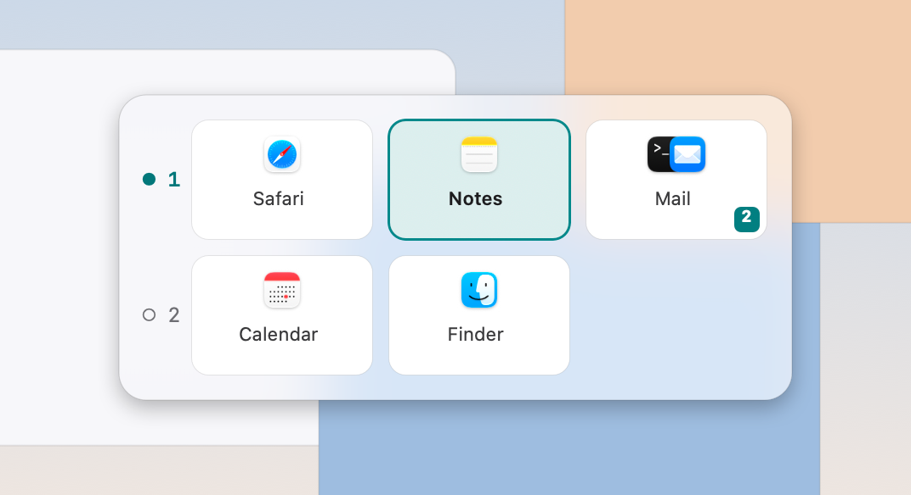
  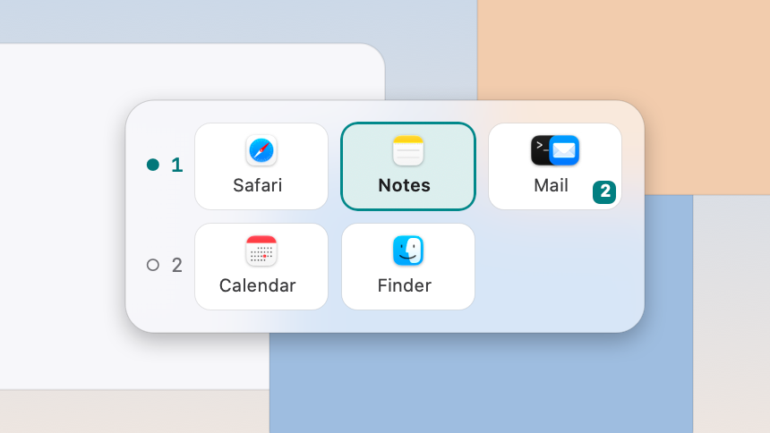
  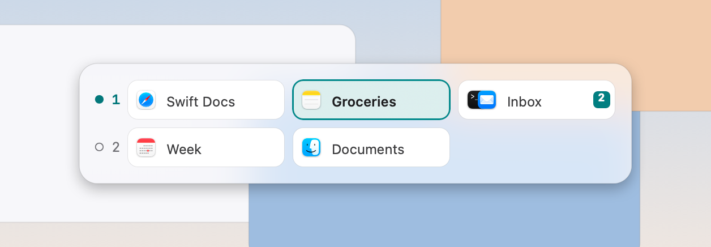
</p>

**Window map.** Left-click the menu-bar icon for a map of every row and column. From it you can drag a
column to another row and use the **Views** menu, which saves and recalls arrangements. Right-click the
icon for the menu: **Settings…**, **Check for Updates…**, **Quit Microfish**.

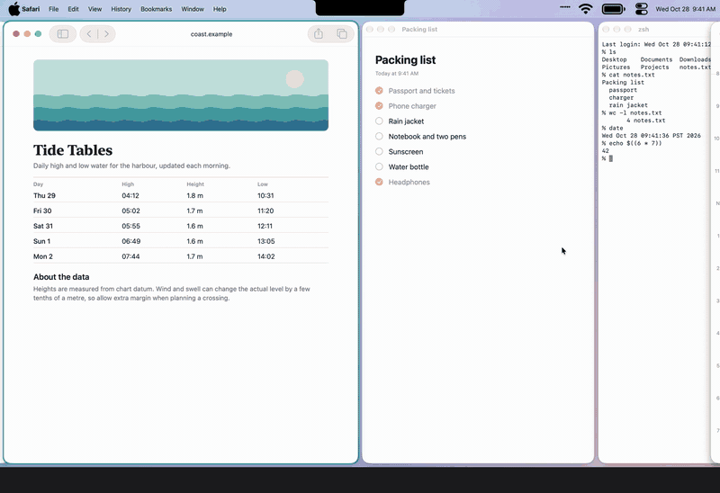

## Keys

**Hyper** is Control-Option-Command (⌃⌥⌘). Caps Lock can be mapped to Hyper with
[Karabiner-Elements](https://karabiner-elements.pqrs.org) (optional). Every shortcut can be changed in
**Settings › Shortcuts**.

| | Default keys |
|---|---|
| Focus | Hyper ← → (or H L) left and right · Hyper ↑ ↓ (or K J) within a stack or between tabs |
| Move | Hyper ⇧ ← → (or H L) swap sideways · Hyper ⇧ ↑ ↓ (or K J) swap within a stack |
| Stacks and tabs | Hyper [ ] stack into the left or right column · Hyper \ unstack · Hyper T show as tabs |
| Size | Hyper R / Hyper ⇧ R wider or narrower · Hyper F full width · Hyper C center · Hyper ⇧ = / − taller or shorter · Hyper E equalize heights |
| Windows and displays | Hyper Space float or tile · Hyper N next display |
| Columns | ⌃⌥ 1–9 focus column N · ⌃⌥⇧ 1–9 swap the focused window with column N |
| Views | Hyper 0–9 go to a saved view (an empty slot saves the current one) · Hyper ⇧ 0–9 replace it · Hyper Tab previous view · Hyper Z undo the last move |
| Rows (turn on in Settings › Rows) | With rows on, Hyper ↑ ↓ (or K J) change rows instead · Hyper ⇧ ↑ ↓ move the window to the row above or below · Hyper ⇧ U / I move the whole column |
| Quit | **Quit Microfish** in the menu-bar icon's menu stops the engine (saving your session) and the app. Hyper Q stops only the engine. |

A three-finger horizontal swipe scrolls the strip, and the scroll modifier (Hyper by default) plus a
scroll does the same. Holding Hyper shows the minimap.

## Settings

Settings are in the menu-bar menu (**Settings…**, ⌘,). The panes are Behavior, Rows, Shortcuts, Appearance,
Minimap, Window Rules and Updates.

<table>
  <tr>
    <td align="center"><b>Behavior</b><br>
      <picture>
        <source media="(prefers-color-scheme: dark)" srcset="docs/media/settings-behavior-dark.png">
        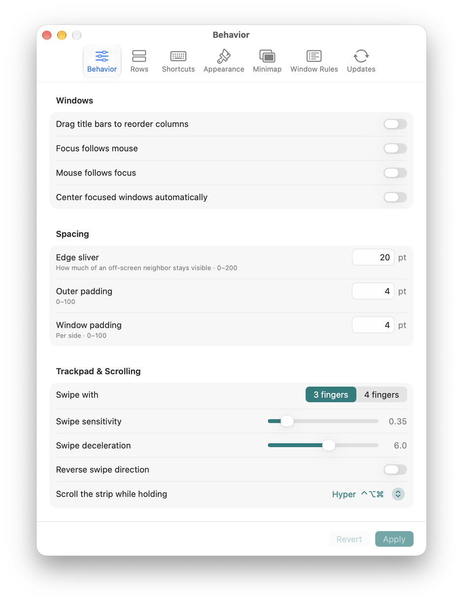
      </picture></td>
    <td align="center"><b>Shortcuts</b><br>
      <picture>
        <source media="(prefers-color-scheme: dark)" srcset="docs/media/settings-shortcuts-dark.png">
        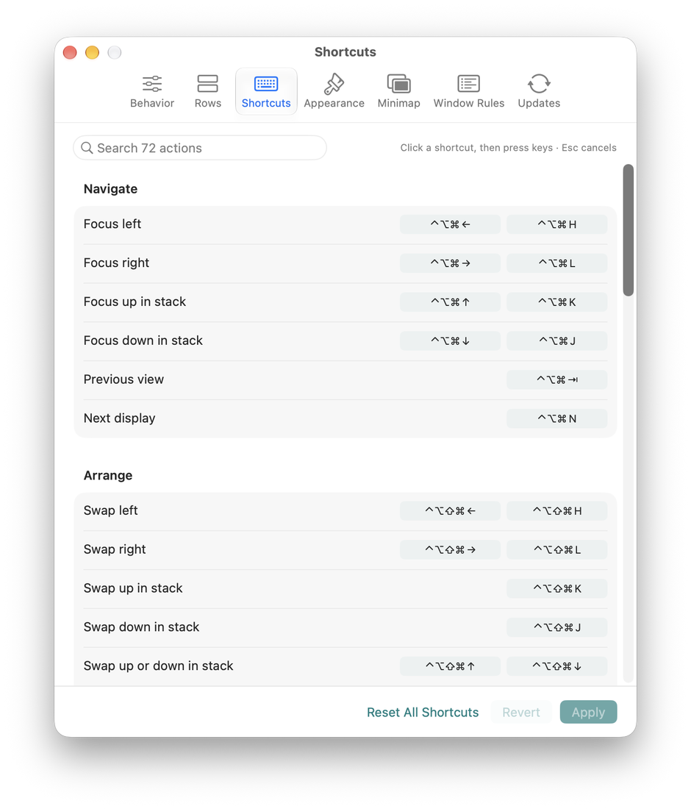
      </picture></td>
  </tr>
  <tr>
    <td align="center"><b>Minimap</b><br>
      <picture>
        <source media="(prefers-color-scheme: dark)" srcset="docs/media/settings-minimap-dark.png">
        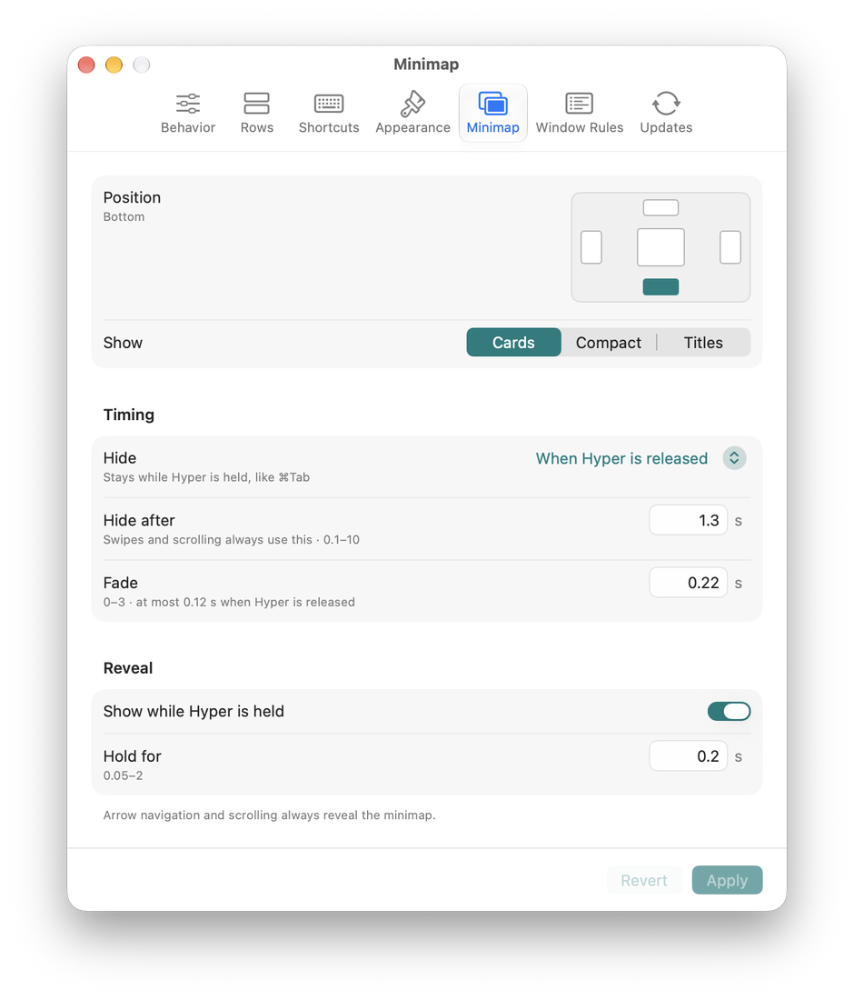
      </picture></td>
    <td align="center"><b>Updates</b><br>
      <picture>
        <source media="(prefers-color-scheme: dark)" srcset="docs/media/settings-updates-dark.png">
        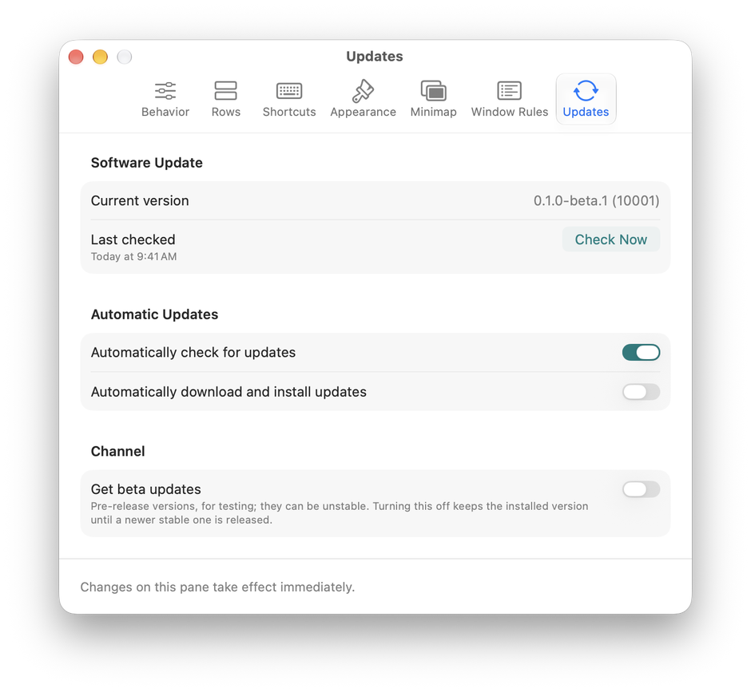
      </picture></td>
  </tr>
</table>

Your files live in `~/Library/Application Support/Microfish/`:

- `preferences.json`: what Settings saves.
- `settings.lua` and `shortcuts.lua`: generated from it. Don't edit them by hand.
- `init.lua`: yours. Microfish's own behaviour loads first, and anything you add below it runs after,
  using Paneru's Lua API (see [SCRIPTING.md](SCRIPTING.md)).
- `State/`: the saved session.

Logs are in `~/Library/Logs/Microfish/`.

## Updates

Microfish uses [Sparkle](https://sparkle-project.org) to check this repository's releases. Every
update is code-signed and notarized by Apple, and signed with an EdDSA key that the app checks before
installing. Before an update replaces the app, Microfish stops the engine cleanly (it saves your
session), then relaunches.

In **Settings › Updates**, **Automatically check for updates** is on by default and **Automatically
download and install updates** is off. **Check for Updates…** is in the menu-bar menu.

**Get beta updates** is off by default. Every release so far is a beta, so a copy of
`0.1.0-beta.1` is offered nothing newer until you turn that switch on. With it on, Microfish also offers
pre-releases, which are tested builds from `main` that later become the next stable version. Turning betas
off never downgrades you: you stay on the beta until a newer stable version arrives.

## Uninstall

1. Choose **Quit Microfish** from the menu-bar icon.
2. Drag Microfish out of Applications into the Trash. With Homebrew, run `brew uninstall --cask microfish`
   instead.
3. Optional: in **System Settings › Privacy & Security › Device Control and Data Access** (Accessibility
   before macOS 27), remove **Microfish** and **Microfish Engine**, and check
   **General › Login Items & Extensions** for a leftover Microfish item.
4. Optional: delete what Microfish wrote:

   ```sh
   rm -r ~/Library/"Application Support"/Microfish ~/Library/Logs/Microfish
   rm -r ~/Library/Caches/net.webreceptor.microfish ~/Library/HTTPStorages/net.webreceptor.microfish
   defaults delete net.webreceptor.microfish
   ```

   With Homebrew, `brew uninstall --zap --cask microfish` does this too. The app's identifier is
   `net.webreceptor.microfish` and the engine's launch agent is `net.webreceptor.microfish.engine`.

## Requirements

- An Apple silicon Mac. Intel is not supported yet.
- macOS 15 or later. Microfish is built for macOS 15 and is developed on macOS 27.
- **Displays have separate Spaces** turned on in **System Settings › Desktop & Dock** (Mission Control). It
  is on by default; the engine refuses to start without it.
- A trackpad for swipes. Keys and scrolling with Hyper work without one.

## Known limits

- This is a beta. There is no stable release, and the only version so far is `0.1.0-beta.1`.
- Apple silicon only.
- Nothing before macOS 27 has been tested, although it is built for 15.
- Rows are off by default, and rows are marked experimental in the engine's own documentation.
- Updating from inside the app has been tested with throwaway keys, but no installed copy has taken an
  update from the real feed yet, so whether your access grants carry over to the next build is unconfirmed.
- Windows that move off-screen leave a thin sliver at the screen edge (**Edge sliver** in
  **Settings › Behavior**), because macOS relocates windows moved fully off-screen.
- Displays arranged side by side can confuse the engine for the same reason. Paneru's documentation
  suggests arranging an extra display above or below the main one. See [PANERU-README.md](PANERU-README.md).
- A build you compile yourself is signed ad hoc, and macOS asks for access again after each rebuild.

## Build from source

You need macOS 15 or later with Xcode 27's command-line tools (`swiftc`, `codesign`) and a Rust
toolchain (`rustup`; `rust-toolchain.toml` picks the version).

```sh
git clone https://github.com/elenaOnline/microfish.git && cd microfish
app/Scripts/fetch-sparkle.sh     # pinned Sparkle release, checked against its SHA-256
app/Scripts/build-app.sh         # builds build/Microfish.app, signed ad hoc
```

`build-app.sh --help` lists the options (`--sign` for a Developer ID, `--package` for a zip). The
helper builds with plain `swiftc`, not SwiftPM or Xcode projects. An ad hoc build gets its own
permission entries, and macOS asks again after each rebuild.

To build only the engine, run `cargo build --release --features microfish`. To run the helper's
headless tests, run `python3 app/Tests/run.py`. To run the engine's tests, run `cargo test`.
[RELEASING.md](RELEASING.md) describes the release pipeline and its branches.

## Layout

| Path | What |
|---|---|
| `src/`, `Cargo.toml` | The engine: Paneru plus Microfish's patches. Upstream's layout is kept so upstream changes can be merged. |
| `app/Sources/` | The Microfish app. `SOURCES` lists what goes into the build. |
| `app/Resources/` | The icon, `Lua/microfish.lua` (Microfish's behaviour), and `Defaults/` (first-run files) |
| `app/Packaging/` | Info.plists, entitlements, the engine's launch agent |
| `app/Scripts/` | Build, package, version, appcast and release scripts |
| `app/Tests/` | Headless tests: no windows, nothing on screen |
| `docs/` | The GitHub Pages site and its media |
| `PANERU-README.md`, `ARCHITECTURE.md`, `CONFIGURATION.md`, `SCRIPTING.md` | Paneru's own documentation, which still describes the engine |

## Credits

- **[Paneru](https://github.com/karinushka/paneru)** by Karinushka and contributors is the engine
  Microfish is built on (MIT). Its full history is in this repository. Most of what makes window
  management work here is theirs.
- **[Sparkle](https://sparkle-project.org)** handles updates (MIT, with notices in
  `Contents/Resources/Credits/`).
- [niri](https://github.com/YaLTeR/niri) and [PaperWM](https://github.com/paperwm/PaperWM) are the
  inspiration for the scrolling model.
- The Rust crates the engine uses are listed with their licenses in
  `Microfish.app/Contents/Resources/Credits/RustDependencies.txt`.

## License

MIT, the same license as Paneru. See [LICENSE.txt](LICENSE.txt), which keeps Paneru's notice and adds
one for the Microfish additions.
